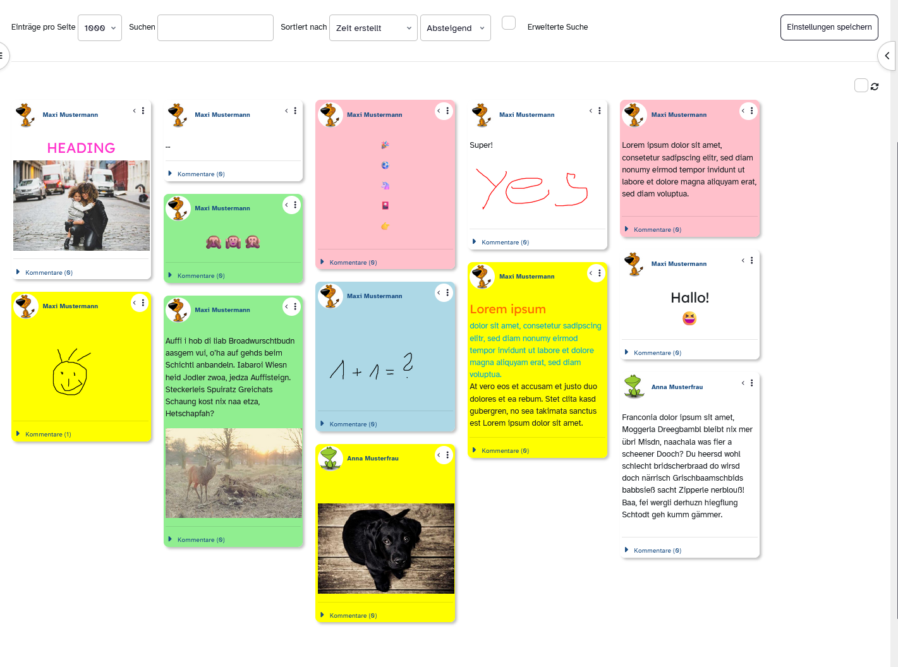
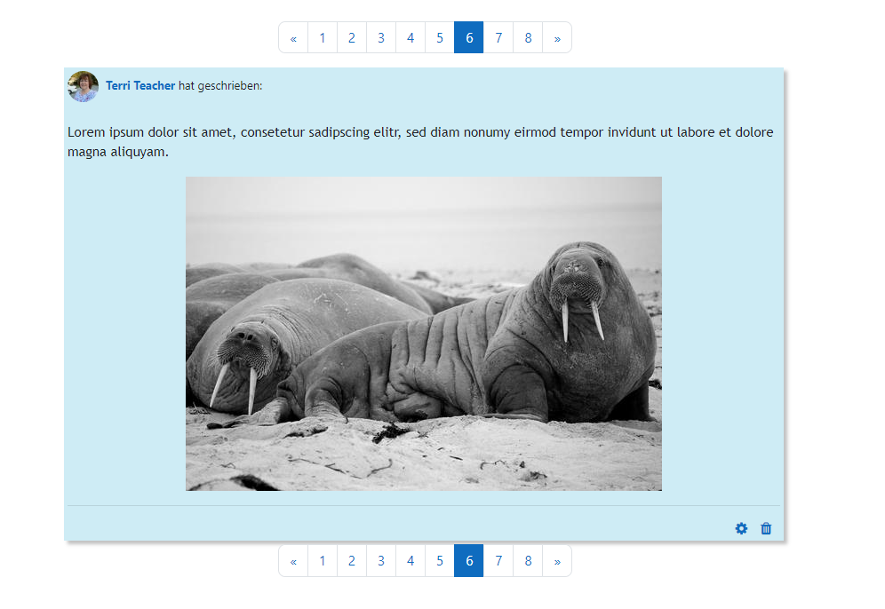

# Sticky Notes

Sticky Notes is a preset for the Moodle activity database.

## Description

Students can post text, images, photos or videos on a sticky note card and
draw sketches on an integrated whiteboard.

Features:

- **Sticky design** – colored cards with soft shadows, slight rotation and a folded corner
- **Whiteboard** – draw with mouse or touch, undo/redo, eraser, color swatches
  and pen sizes; drawings are stored as compact JSON vector strokes (not large
  PNG data URLs), so entries stay small and drawings render sharply at any size
- **Color filter** – quick filter buttons above the board to show only cards of one color
- **Responsive board layout** – pure CSS columns, no JavaScript library needed
- **Auto reload** – optional, refreshes the board every 4 seconds
- **Ratings ("Likes")** – enable *Ratings* in the database activity settings and
  the rating widget appears below every card automatically
- Accessibility: labelled tools, keyboard focus styles, canvas ARIA labels

Old entries whose whiteboard was saved as PNG data URL are still displayed
(and can be edited – they are converted on the next save).

No external JavaScript libraries are used – everything is Vanilla JS.

## Getting started

Download the source code and zip the files WITHOUT parent folder or download the ZIP file. Create a "Database" activity in Moodle and then upload the ZIP file in the "Presets" tab under "Import".

After importing, open the *Templates* tab of the database activity and paste
the template files into the matching template fields (list, single, add, CSS, JavaScript).

### Enable ratings

In the database activity settings, expand *Ratings* and set the roles and
aggregate type. The rating widget then shows up under each card.

## Language Support

The preset is available in German, but there is not so much to translate. The template can easily be adapted.

## Credits

Canvas drawing inspired by
Lei Mao: https://leimao.github.io/blog/HTML-Canvas-Mouse-Touch-Drawing/

## Screenshots

